# Pastery Secure

One-time, end-to-end encrypted pastes. Inspired by [Ente Paste](https://ente.io/paste).

Paste some text (up to 4,000 characters) and get a link. Your browser encrypts the text before anything is uploaded. The server only ever holds ciphertext. The paste is deleted the first time someone opens it, and unopened pastes expire after 24 hours. There are no accounts.

## How the encryption works

All encryption and decryption happens in the browser using the [Web Crypto API](https://developer.mozilla.org/en-US/docs/Web/API/Web_Crypto_API) (`lib/crypto.ts`).

1. **Create.** The browser generates a fresh random AES-256-GCM key and a random 12-byte IV, then encrypts the UTF-8 text.
2. **Upload.** Only the ciphertext, the IV, a format version (`1`) and a 16-byte key check go to the `createPaste` Convex mutation. The key check is the first 16 bytes of `SHA-256("pastery-keycheck-v1" || rawKey)` (`lib/linkKey.ts`). The server returns a random 10-character base62 slug.
3. **Share.** The link has the form `https://<host>/p/<slug>#<key>`, where `<key>` is the raw key encoded as 43-character base64url. Browsers don't send the URL fragment (the part after `#`) in requests, so the key never reaches the server.
4. **Gate.** The reveal page subscribes to the `peekPaste` query, which only says whether the slug exists and hasn't expired (it never returns ciphertext). If the paste is already gone, the page says so straight away instead of offering a Reveal button that can't work. The check is reactive, so if someone else opens the paste while the page is open, it switches to "gone".
5. **Open.** The recipient clicks **Reveal paste**. The browser first checks the fragment locally: it must be base64url that decodes to exactly 32 bytes and imports as an AES key. If it doesn't, the page reports the link as damaged and never contacts the server. Otherwise it calls `openPaste(slug, keyCheck)`. If the key check doesn't match the stored one, the server returns `badKey` and leaves the paste alone; the page reports the link as damaged. If it matches, the server deletes the row and returns the ciphertext and IV in the same transaction, and the browser decrypts them with the key from the fragment.

A damaged link (truncated, mangled or otherwise wrong key) therefore doesn't burn the paste: the sender can resend the correct link and it still works. The only case where a paste is deleted and then fails to decrypt is tampered ciphertext or an unknown version, or a paste created before key checks existed (those rows have no `keyCheck` and keep the old burn-on-open behaviour).

The server stores the ciphertext, IV, version, key check, slug, expiry time and a scheduled-cleanup job ID. It never sees the key or the plaintext. The key check doesn't weaken this: the key is 256 random bits, so a truncated SHA-256 of it can't be brute-forced or used to decrypt anything.

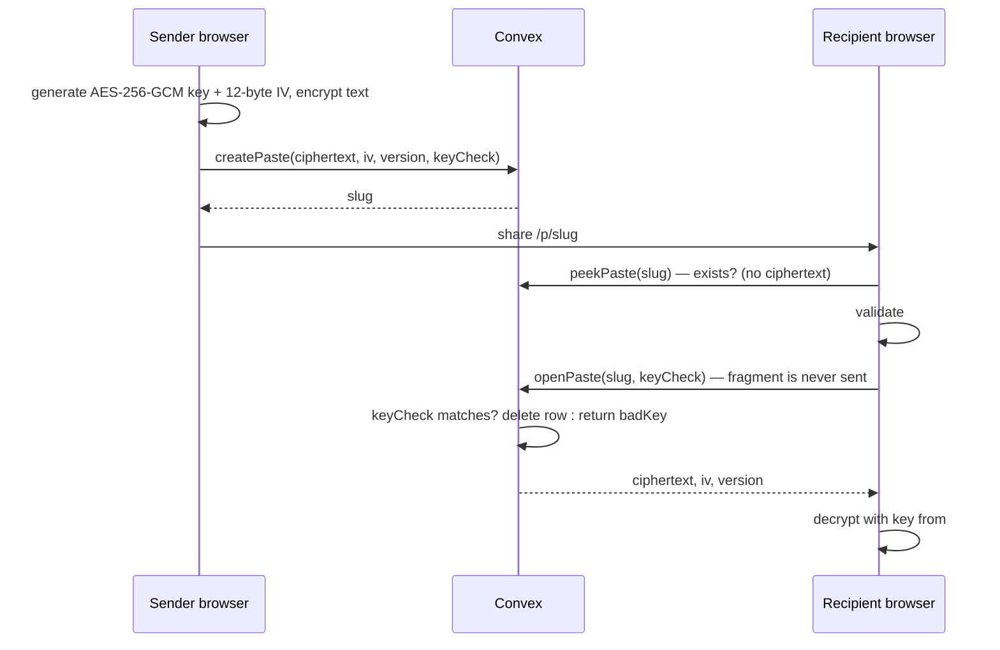

## Security model and limits

- **The link is the secret.** Anyone who has the full link, fragment included, can read the paste once. If someone else opens it first, the intended recipient will only see "This paste is gone".
- **Burn on first open.** `openPaste` deletes the paste before returning it. Each paste can be read once, no more. The reveal page waits for an explicit click, so link previewers that only fetch the page don't burn it. Only a request carrying the right key check burns a paste, so a damaged link, or someone who knows just the slug, can't destroy it. If you open a link you created in the same browser session, the app asks you to confirm first. It tracks your links in `sessionStorage`.
- **24-hour lifetime.** Each paste schedules its own deletion at `expiresAt`. As a safety net, an hourly cron (`sweepExpired`) deletes any expired rows that are left, 100 at a time.
- **Size cap.** The UI limits input to 4,000 characters. The server rejects empty ciphertext, ciphertext over 16,080 bytes (4,000 × 4 UTF-8 bytes + 16-byte GCM tag + 64 bytes headroom), and any IV that isn't exactly 12 bytes.
- **Rate limits** (`@convex-dev/rate-limiter`, token buckets):
  - `createPaste`: 60 per minute
  - `openPaste`: 600 per minute

  These buckets have no key, so they apply to the whole deployment, not to each client. They protect the backend from floods but don't stop a single abuser from using up the shared budget.
- **Content Security Policy** (`next.config.ts`): `default-src 'self'`, with `connect-src` limited to `'self'` plus the Convex deployment origin (https and wss). It also sets `frame-ancestors 'none'`, `object-src 'none'`, `base-uri 'self'` and `form-action 'self'`. `script-src` has to include `'unsafe-inline'`: Next.js streams inline `<script>` tags for the RSC payload, and static headers can't carry per-request nonces. `'unsafe-eval'` is added only in development.
- **Other headers:** `Referrer-Policy: no-referrer`, `X-Content-Type-Options: nosniff`, `X-Frame-Options: DENY`, and a restrictive `Permissions-Policy`.
- **No indexing of pastes.** `/p/*` responses carry `X-Robots-Tag: noindex, nofollow`, and the paste layout sets `robots: { index: false, follow: false }` metadata.
- **No analytics or third-party scripts.** Fonts come from `next/font`, which self-hosts them at build time. The only external origin the page connects to is the Convex backend.
- **What this doesn't protect against:** a compromised server serving malicious JavaScript, a compromised device on either end, links that linger in chat logs or browser history, and a recipient copying or screenshotting the text after reveal. The server can also see roughly how long a paste is and when it was created and opened. The in-app `/how-it-works` page covers the same ground.

## Tech stack

- [Next.js](https://nextjs.org) 16 (App Router, Turbopack, `cacheComponents`), React 19, TypeScript
- [Convex](https://convex.dev) for the database, mutations, the scheduler and crons
- [`@convex-dev/rate-limiter`](https://www.npmjs.com/package/@convex-dev/rate-limiter) Convex component
- Tailwind CSS v4, shadcn/ui components on Base UI, lucide-react icons, sonner toasts
- Vitest for unit tests and Playwright for the screenshot walkthrough

## Project structure

```
app/
  layout.tsx               Root layout, Convex provider, toaster
  ConvexClientProvider.tsx Client-side ConvexReactClient
  page.tsx                 Create page: encrypt + upload, show share link
  p/[id]/page.tsx          View page: gate → reveal → decrypt; gone/damaged/missing-key states
  p/[id]/layout.tsx        noindex metadata for paste pages
  how-it-works/page.tsx    Plain-language explanation of the security model
  not-found.tsx            404 page
components/ui/             shadcn/ui components (button, card, dialog, …)
convex/
  schema.ts                `pastes` table
  pastes.ts                Mutations, query, rate limiter
  crons.ts                 Hourly expiry sweep
  convex.config.ts         Registers the rate-limiter component
lib/
  crypto.ts                AES-256-GCM encrypt/decrypt, key import/export
  encoding.ts              base64url encode/decode
  linkKey.ts               Fragment validation + key check (commitment) helper
scripts/screenshots.mjs    Playwright end-to-end walkthrough + screenshots
tests/crypto.test.ts       Vitest tests for crypto and encoding
tests/linkKey.test.ts      Vitest tests for fragment validation and the key check
screenshots/               Generated screenshots (desktop + mobile)
next.config.ts             CSP and security headers
```

## Convex schema and functions

**`pastes` table** (`convex/schema.ts`)

| Field          | Type                             | Notes                                 |
| -------------- | -------------------------------- | ------------------------------------- |
| `slug`         | `string`                         | Random 10-char base62, used in URL    |
| `ciphertext`   | `bytes`                          | AES-GCM output (includes auth tag)    |
| `iv`           | `bytes`                          | 12 bytes                              |
| `version`      | `number`                         | Crypto format version (currently `1`) |
| `expiresAt`    | `number`                         | ms timestamp, creation + 24h          |
| `cleanupJobId` | `Id<"_scheduled_functions">?`    | Scheduled deletion job                |
| `keyCheck`     | `bytes?`                         | 16-byte key commitment; absent on older rows |

Indexes: `by_slug`, `by_expiresAt`.

**Functions** (`convex/pastes.ts`)

| Function        | Kind               | What it does                                                                                                   |
| --------------- | ------------------ | -------------------------------------------------------------------------------------------------------------- |
| `createPaste`   | public mutation    | Rate-limits, checks the sizes (`keyCheck` must be 16 bytes), generates a unique slug, inserts the row, schedules `deletePaste` at `expiresAt` |
| `openPaste`     | public mutation    | Takes `slug` and `keyCheck`. Rate-limits and looks up by slug. Returns `{status: "gone"}` if missing/expired, or `{status: "badKey"}` without deleting if the row has a `keyCheck` that doesn't match. Otherwise cancels the scheduled cleanup, deletes the row and returns `{status: "ok", ciphertext, iv, version}` |
| `peekPaste`     | public query       | Returns whether a slug exists and hasn't expired, plus `expiresAt`. Never returns ciphertext. The reveal page subscribes to it to show "gone" before Reveal |
| `deletePaste`   | internal mutation  | Scheduled per-paste deletion                                                                                   |
| `sweepExpired`  | internal mutation  | Deletes up to 100 expired rows. If more remain, it schedules itself again. Runs hourly from `crons.ts`      |

## Local setup

Requires Node.js and a (free) Convex account.

```bash
npm install
npx convex dev   # first run: log in, create/select a project; keeps running and pushes convex/ changes
```

`npx convex dev` writes the deployment settings to `.env.local`, which is gitignored. The app needs this variable:

| Variable                 | Purpose                                                                   |
| ------------------------ | ------------------------------------------------------------------------- |
| `NEXT_PUBLIC_CONVEX_URL` | Convex deployment URL, e.g. `https://<your-deployment>.convex.cloud`. Used by the client and the CSP `connect-src` |

Then, in a second terminal:

```bash
npm run dev      # http://localhost:3000
```

`NEXT_PUBLIC_CONVEX_URL` is read when `next.config.ts` builds the CSP. Restart `npm run dev` after you change it.

## Scripts

| Command         | Description                          |
| --------------- | ------------------------------------ |
| `npm run dev`   | Start the Next.js dev server         |
| `npm run build` | Production build                     |
| `npm run start` | Serve the production build           |
| `npm run lint`  | Run ESLint                           |
| `npm test`      | Run the Vitest unit tests once       |

**Screenshots / end-to-end walkthrough.** `scripts/screenshots.mjs` isn't an npm script. It runs a full create → share → reveal → gone → missing-key flow in Playwright Chromium at desktop (1280×800) and mobile (390×844) sizes. It also opens an already-burned link in a fresh browser (it must show "gone" without a click) and tries a paste with a wrong key and a truncated key (both must show "damaged"), then checks that the correct link still reveals the paste. It checks that the decrypted text matches what was entered, and saves PNGs to `screenshots/`. It exits non-zero on any console error, page error or failed request.

```bash
npx playwright install chromium         # once
npm run build && npm run start -- -p 3123
node scripts/screenshots.mjs            # defaults to http://localhost:3123
node scripts/screenshots.mjs http://localhost:3000   # or pass a base URL (or set BASE_URL)
```

## Screenshots

| Create | Share link |
| ------ | ---------- |
| 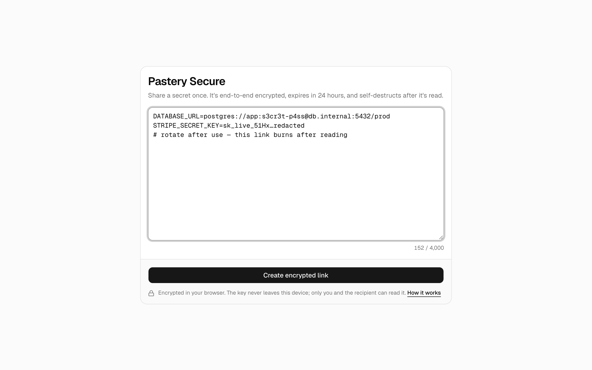 | 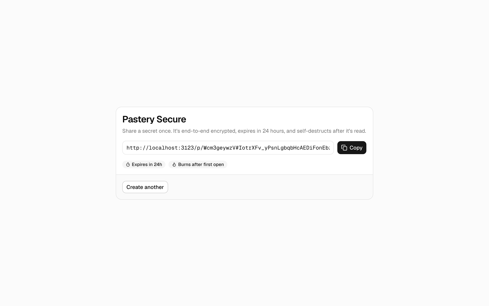 |

| Reveal gate | Revealed |
| ----------- | -------- |
| 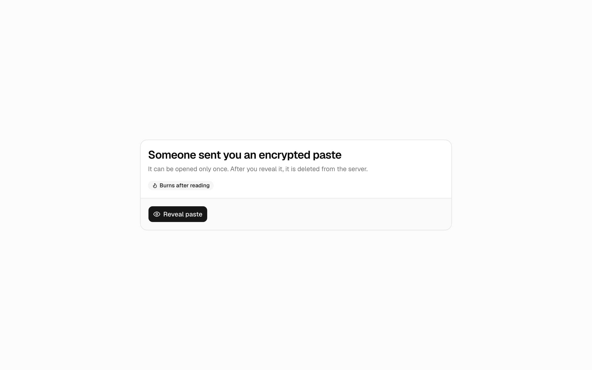 | 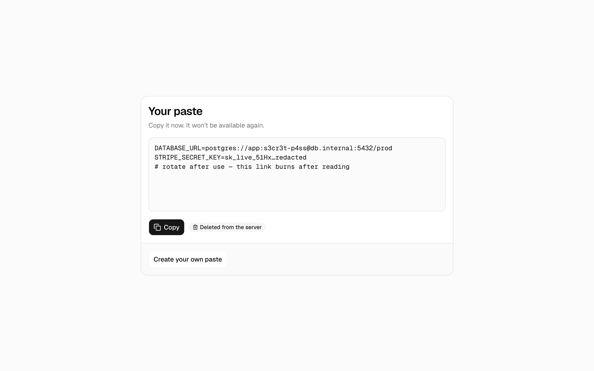 |

| Already opened | Own-link confirmation |
| -------------- | --------------------- |
| 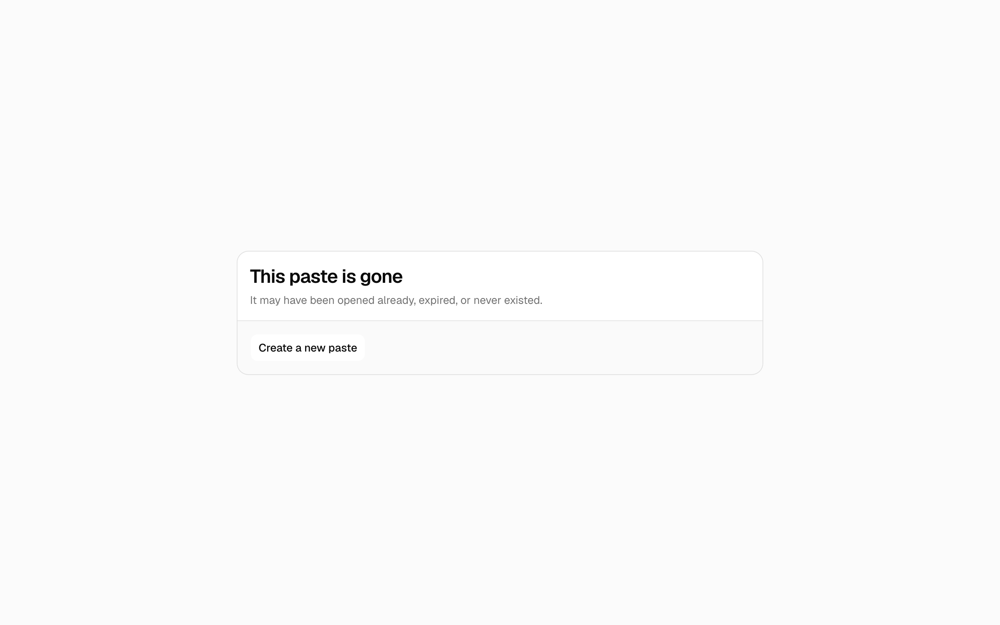 | 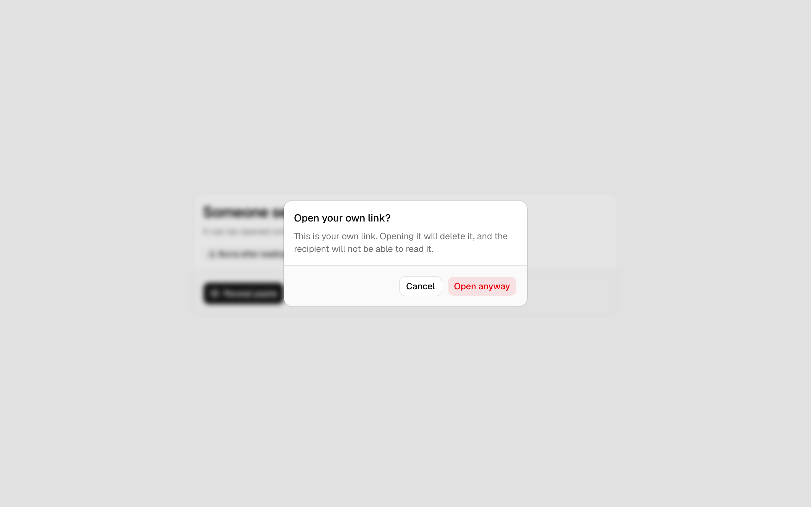 |

| Gone, before Reveal | Damaged link (paste kept) |
| ------------------- | ------------------------- |
|  | 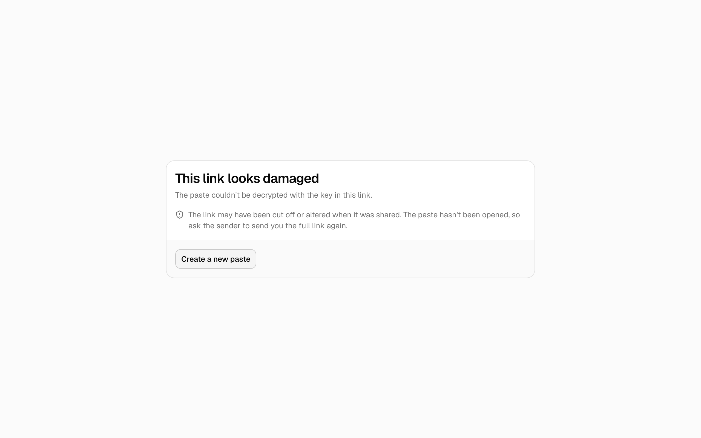 |

Mobile:

<p>
  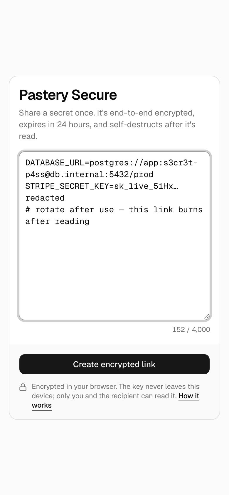
  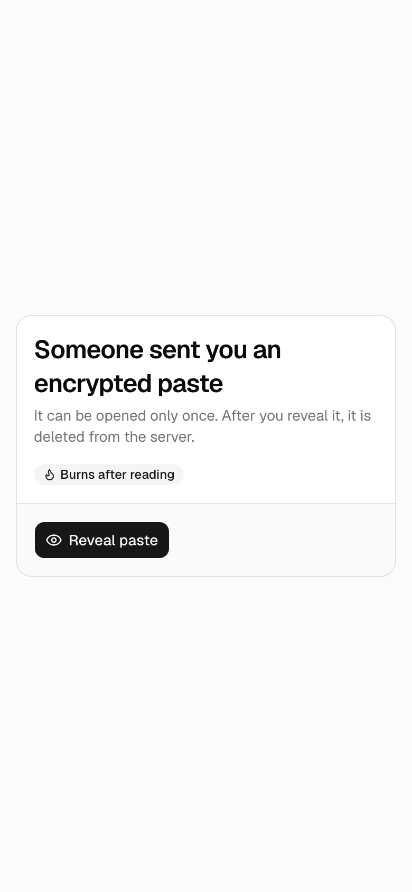
  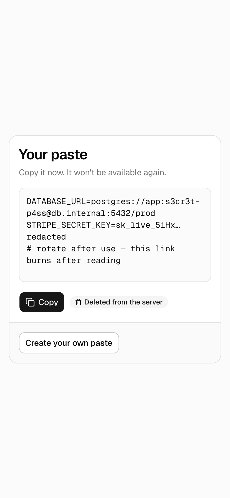
</p>
